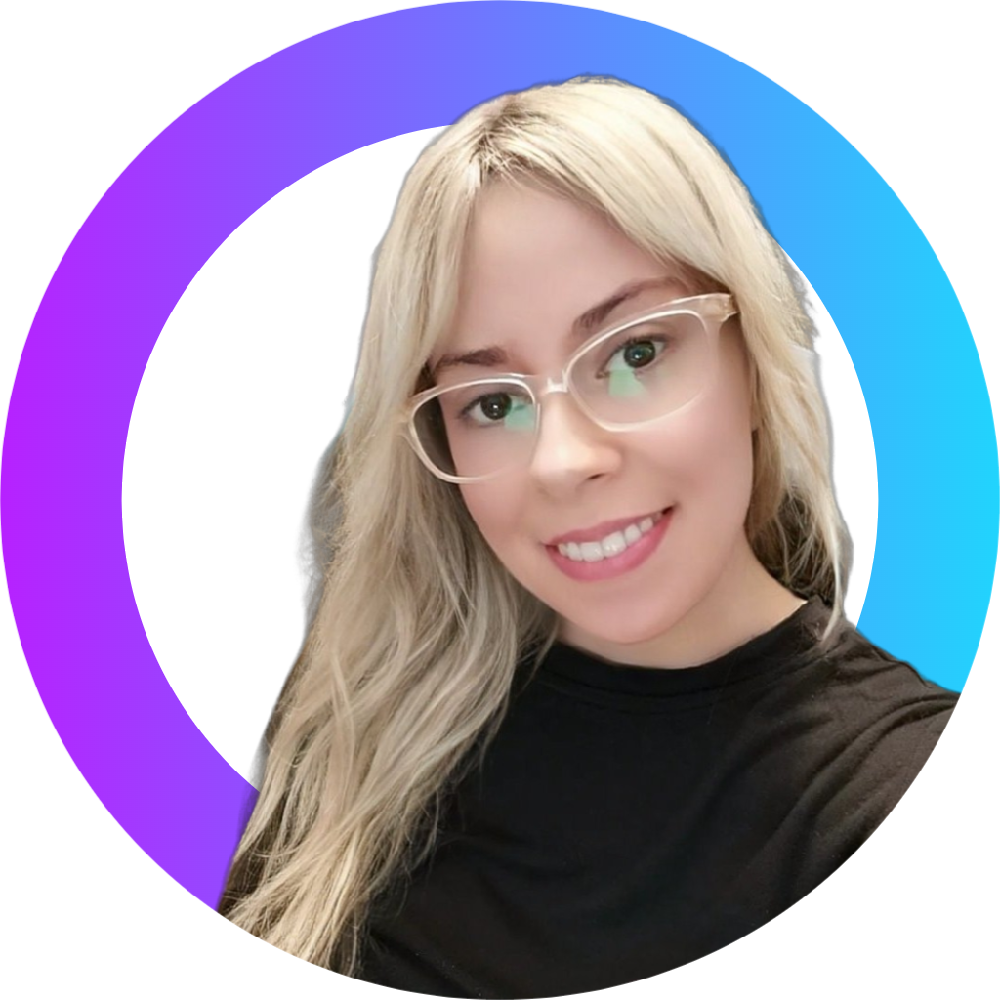

<div align="center">




<br/>

### 👋 Hi, I'm Estefanía!

**Full Stack Developer · Computer Engineering Student · DevOps Enthusiast**

Building digital experiences, learning new technologies and turning ideas into code.

<br/>

[](https://www.linkedin.com/in/estefaniagm89/)
[](https://github.com/EstefaniaGM89)
[](https://github.com/EstefaniaGM89)


</div>

---

## 💜 About Me

```typescript
const estefania = {
  location: "Barcelona, Spain",
  role: "Full Stack Developer",
  education: [
    "Higher Technician in Web Application Development",
    "BSc Computer Engineering - UOC (in progress)"
  ],
  interests: [
    "Web Development",
    "Software Engineering",
    "Cloud & DevOps",
    "UI/UX",
    "Artificial Intelligence"
  ],
  currentlyLearning: [
    "Python",
    "Docker",
    "CI/CD",
    "Jenkins",
    "Terraform",
    "AWS & Azure"
  ],
  motto: "Keep learning. Keep building."
};
```

I'm a passionate developer with a background in **Web Application Development** and professional experience creating responsive and accessible digital solutions.

I have worked on institutional websites, contributed to an AI-powered iOS application and developed full-stack web projects.

Currently pursuing a **Computer Engineering degree at UOC**, while expanding my knowledge of DevOps, cloud infrastructure and automation.

My journey into technology started with an **Amstrad CPC 464 at the age of three**. The curiosity never left. 🎮

---

## ⚡ Tech Stack

### 🎨 Frontend Development

<div align="center">


</div>

### ⚙️ Backend Development

<div align="center">


</div>

### 🗄️ Databases & ORM

<div align="center">


</div>

### 🛠️ Development Tools

<div align="center">


</div>

### ☁️ Currently Exploring — DevOps & Cloud

<div align="center">


<br/><br/>


</div>

---

## 🚀 Featured Projects

### ⌨️ JustType AI Keyboard

**AI-powered iOS keyboard with intelligent autocorrection, multilingual translation and ChatGPT integration.**

Contributed to iOS development, Spanish localization and digital marketing activities.

`Swift` `Xcode` `iOS` `AI` `Digital Marketing`

[](https://apps.apple.com/us/app/justtype-ai-keyboard/id6590604907)

### 💊 MediTrack

**Healthcare web application designed to manage patients, medications and treatment tracking.**

Built as a full-stack web development project, focusing on structured data management and usability.

`PHP` `Laravel` `MySQL` `Bootstrap`

### 🌐 Developer Social Platform

**Full-stack social networking project for developers.**

Built with a modern TypeScript ecosystem, modular architecture and relational data management.

`React` `TypeScript` `Next.js` `NestJS` `PostgreSQL` `Prisma`

---

## 💼 Professional Experience

**Web Development Support Specialist — Ajuntament de Mataró**

*October 2025 – September 2026*

- Developed and maintained responsive institutional web content.
- Worked with HTML, CSS, Bootstrap and Plone CMS.
- Applied web accessibility and usability principles.
- Collaborated with multidisciplinary teams on public-sector digital projects.

**iOS Development & Digital Marketing Intern — JustType AI Keyboard**

*March 2025 – June 2025*

- Contributed to iOS development using Swift and Xcode.
- Supported localization and multilingual features.
- Participated in digital marketing and app promotion.

---

## 📊 GitHub Analytics

<div align="center">


</div>

### 🟣 Contribution Activity

<div align="center">


</div>

---

## 🎯 Current Goals

- 🚀 Strengthen my Full Stack development skills.
- ☁️ Gain hands-on experience with Docker, CI/CD and cloud infrastructure.
- 🐍 Improve my Python skills for automation and backend development.
- 🎓 Continue my Computer Engineering degree.
- 💼 Grow professionally in software development and DevOps environments.

---

<div align="center">

### 🤝 Let's Build Something Great

I'm interested in opportunities where I can contribute, keep learning and grow as a developer.

[](https://www.linkedin.com/in/estefaniagm89/)

<br/>

*"Great software starts with curiosity."*


</div>
